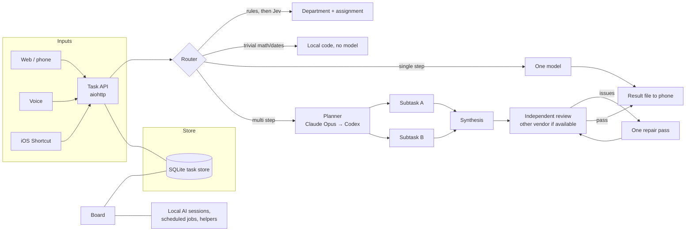

# Donaro

One inbox for every AI model I use. I type or speak a request on my phone, and Donaro decides which model does the work, checks the result with a different model, and hands back a file. Underneath it keeps a typed record of every task so I can see, cancel or retry any of them from one board.

I built it because I run a one-person consultancy across nine areas of work (client policy work, research, content, finance, and so on) and was spending more time switching between AI apps and babysitting quota errors than doing the work.

This repository is a curated extract of the running system. Client data, conversation logs, keys and the local database are not here.

## What it does

- **Single entry point.** Web, voice and iOS Shortcuts all post to the same task API. The phone reaches the PC over Tailscale; nothing is exposed to the public internet.
- **Routing in three layers.** Cheap, fast judgments (which department, is this a real request) go to rules first and to a small typed-judgment model (Jev) only when rules can't decide. Short answers go to a fast model. Planning, code changes and final review go to the top models (Claude Opus first, Codex as fallback).
- **Plan, execute, review.** For multi-step work the planner splits the request into subtasks with a token budget, independent subtasks run in parallel, and the result is reviewed by a top-tier model, from a different vendor than the writer whenever one is available.
- **Quota-aware failover.** When a provider hits its limit, the router records the reset time and skips that provider until then instead of retrying blindly. If every option in a chain is exhausted, the task waits and resumes on its own.
- **Isolated code changes.** Code tasks run in a per-task git worktree. Models return file patches; the server checks paths and context, runs the checks, and only then merges. Models never get a shell on the main checkout.
- **Safe restarts.** After a server restart, read-only tasks resume. Write tasks are not re-run automatically; they are marked `needs_reconciliation` so nothing is applied twice.
- **One board for everything.** The board shows Donaro tasks live (step, elapsed time, last output), Claude Code and Codex sessions opened elsewhere on the PC, scheduled jobs, the status of always-on helpers, and daily token use. Cancel, retry and restart are on the board, each with a confirm step.

## Architecture



## Protecting client data

The policy work involves confidential client material, so the rule is simple: client information never goes to a non-Claude model, to text-to-speech services, or to GitHub.

- `orchestrator.is_gr()` flags a task as confidential if its department is the policy department, or if the request, attachments or context contain policy signal words or any client term. The client term list lives in private files outside the repository. If those files can't be read, every task is treated as confidential.
- Confidential tasks can only run on Claude. If Claude is unavailable they wait rather than fall back to another vendor.
- The board masks confidential session titles as `[GR 업무]`.
- `export_public.py` builds this repository and refuses to finish if it finds a client term, a key pattern, a value from any local `.env`, an account name, an email address, a Tailscale host, a Notion ID or a phone number.

## Layout

```
donaro/          server and orchestration (Python, aiohttp, SQLite)
  server.py          HTTP API, task lifecycle, board data
  orchestrator.py    model registry, fallback chains, confidentiality check
  task_router.py     routing, quota tracking, local answers
  task_workers.py    Claude, Codex and API workers
  task_worktrees.py  per-task git worktrees and patch validation
  task_store.py      SQLite store and restart recovery
  activity.py        local AI sessions, scheduled jobs, helpers, daily usage
  jev.py             fast typed-judgment layer
  harness_*.py       offline test harnesses
board-ui/        board and chat UI (React, React Flow, shadcn/ui)
docs/            ontology draft and decision records
CASE_STUDY.md    the problem, what I tried, what changed
```

## Running the tests

The offline harnesses need only Python and git. The confidentiality check fails closed when there is no client term list, so give it the example list first:

```
cd donaro
cp gr_terms_private.example.txt gr_terms_private.txt
python harness_gr.py
python harness_context.py
python harness_planner.py
python harness_worktrees.py
python harness_worktree_server.py
```

The server itself expects my local setup (model CLIs, a gateway for API models, private term files), so it won't start as-is. The code is here to be read.

## Numbers so far

From the first live task on 7 November 2026 to 16 November 2026: 82 real tasks (test runs excluded), 47 completed without help (57%), 17 waiting on my decision, 11 failed. 135 logged model calls cost USD 28.65 in total. The very first call was "what is 2 plus 2", which used 60,043 cache tokens; arithmetic and dates are now answered by local code with no model call.

---

## 한국어 요약

도나로는 휴대폰 하나로 여러 AI에게 일을 맡기는 개인용 창구입니다. 요청을 받으면 부서를 정하고, 쉬운 판단은 규칙과 Jev, 짧은 답은 빠른 모델, 기획·코드·최종 검수는 상위 모델에 맡깁니다. 검수는 가능하면 만든 모델과 다른 회사의 상위 모델이 맡고, 한도에 걸리면 복구 시각까지 기다렸다가 저절로 다시 시작합니다. 코드 변경은 작업마다 따로 만든 git worktree에서만 하고, 검사를 통과해야 원본에 반영합니다.

고객 정보는 Claude 외 모델, 음성 합성, GitHub로 나가지 않습니다. 이 저장소는 운영 중인 시스템에서 핵심 코드만 추린 것이고, 공개 전에 고객 이름·비밀값·개인 정보가 0건인지 스크립트로 확인합니다.

## License

Shared for reading only. No license is granted; all rights reserved.
